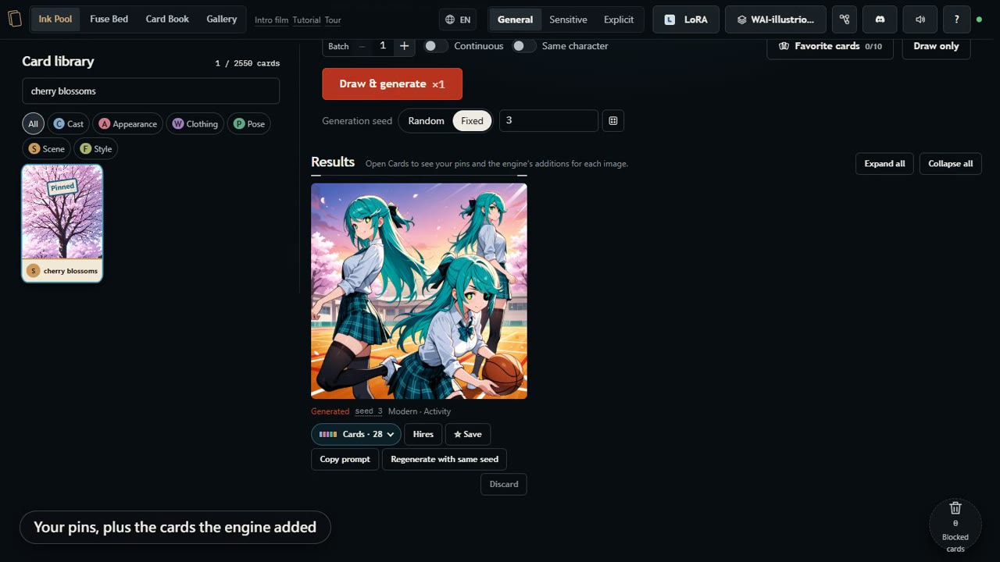
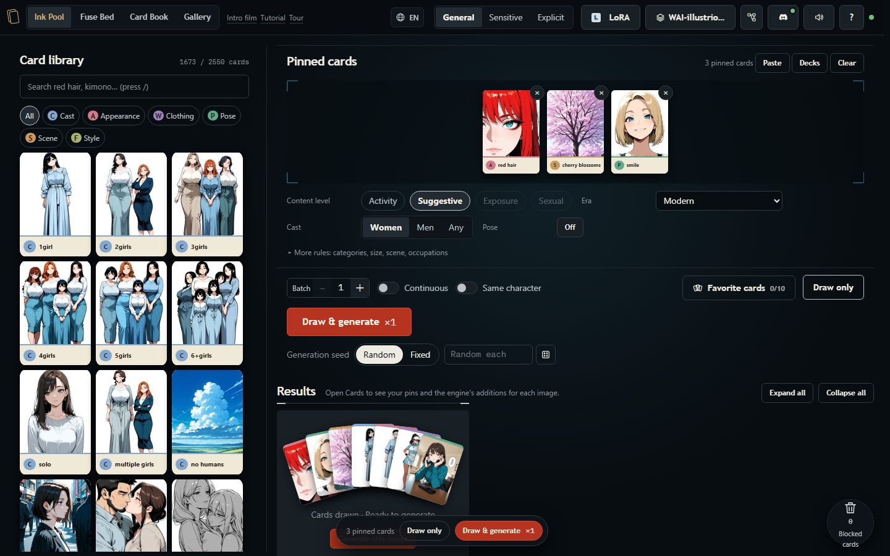
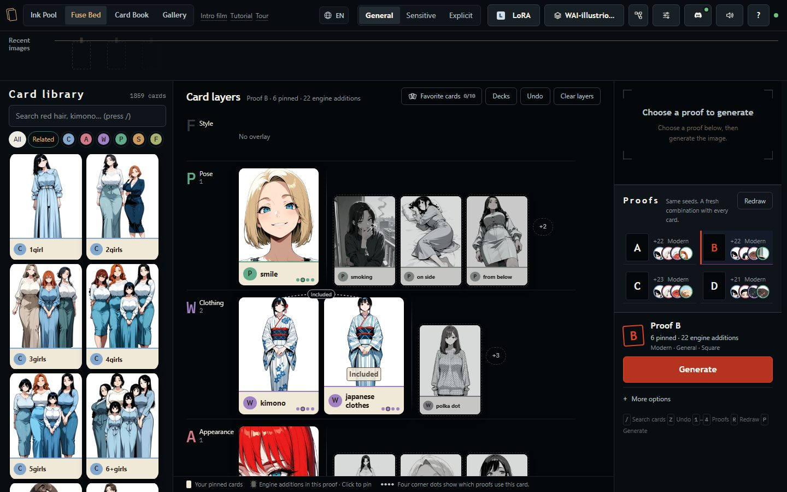
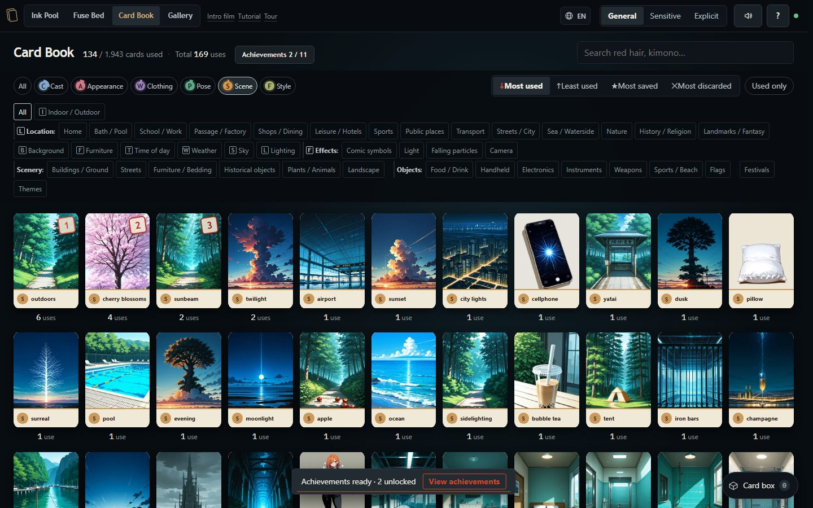
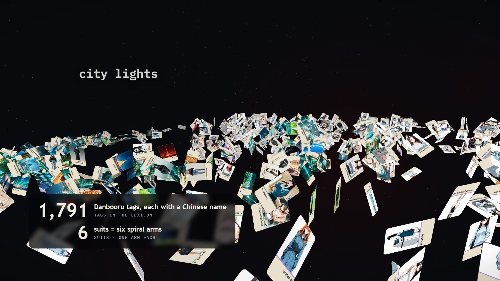

# Mochi · a card workbench for Danbooru-tag image generation

[](https://github.com/bosen12/danbooru_tag_mochi/actions/workflows/test.yml)

Created by [bosen12](https://github.com/bosen12) · Code: GPLv3

English · [繁體中文](#繁體中文)

Danbooru tags as illustrated cards. Pin a few cards, let the engine draw the rest by its rules, and send the composition to your local ComfyUI (WAI / Illustrious SDXL).

The interface is in English or Traditional Chinese. It follows your browser language, and the globe menu in the top bar switches it. ComfyUI always receives the canonical English tags.

> **Adult content.** This tool can generate adult images. The rating switch starts at *General*. The lexicon and negative prompt block `loli`, `shota`, `teen`, `child` and similar tags; those cards are never drawn or illustrated.
> The server runs on your own machine and only accepts loopback and Tailscale connections by default.

Mochi is the card interface of [danbooru_tag_random](https://github.com/bosen12/danbooru_tag_random), released on its own.

<p align="center">
  <a href="https://github.com/bosen12/danbooru_tag_mochi/raw/main/.github/mochi-demo.mp4">
    
  </a><br>
  <sub>▶ 1-minute demo, recorded live against a real ComfyUI (General content level)</sub>
</p>

| Ink Pool | Fuse Bed |
|---|---|
|  |  |
| **Card Book** | **Intro film** (rendered live in the page) |
|  |  |


## Four rooms

| Room | What it does |
|---|---|
| **Ink Pool** `/` | Browse the card library by suit (Cast, Characters, Appearance, Clothing, Pose, Scene, Style), or search in English or Chinese. Pinned cards appear in every image; the engine fills the remaining slots. Rules set content level, era, characters, pose reference and size. Batch, continuous and draw-only modes. |
| **Fuse Bed** `/fuse.html` | One card per ink layer. Pinned cards stack into six suit rows; grey shadows are the engine's additions. Four same-seed proofs redraw instantly, so you see what each card changes before you generate. |
| **Card Book** `/book.html` | How often each card was used, its save and discard rates, and the images it appeared in. Achievements. |
| **Gallery** `/album.html` | Saved images, the full generation history, and a report card for every checkpoint and LoRA. **Print this again** sends a work's cards, weights, era, seed, size, checkpoint and LoRA back to the Ink Pool; tap a card name to open it in the Card Book. |

**Choose a workflow.** The Ink Pool randomly picks three starters from the same 30-story catalog as the Fuse Bed and has a visible size selector. Use **More starters** for another group; an empty workspace picks a new group when reopened or cleared, while ordinary redraws keep the current choices. The Fuse Bed shows four candidate prompts, with readable hair, clothing, pose and scene summaries; ≠ marks differences from the selected proof. Printing generates the image. On phones, the candidates appear before the card layers. Each workspace keeps its own cards and settings; use **Take cards** to transfer the selection and its weights explicitly.

**Choose supplemental kinds.** At counts 1–4 for appearance, clothing and pose, or 1–3 for scene, choose the kinds to supplement. Each kind receives at most one random card; required dependencies may add related tags. Higher counts retain free drawing. **More kinds** includes species, makeup, nudity, garment state, sex, exposure, weather, props and lens effects. Selecting a content level permits candidates; it does not override your chosen kinds. Pinned cards, required draws and their necessary dependencies stay, subject to compatibility rules.

**Keep cards for later.** Favorites hold up to ten individual cards per workspace; the Card Book's box holds up to 24 cards to use next. Decks save a full selection and its weights for reuse. The Gallery distinguishes recipe-only works from images that failed to load, and offers a retry for the latter.

**Characters.** 612 adult anime and game characters (Yor, Makima, Raiden Shogun, Levi…) are cards in their own suit, grouped by series under Anime and Games (One Piece, Demon Slayer…; Arknights, Genshin Impact…). Pin one or several, or turn on **Draw characters** in the Ink Pool rules to give people of the selected gender named characters (up to three, any series). Pinned characters remain even when their gender is switched off. **Same series only** keeps every drawn character in the pinned character's series, or picks one series that fits the cast when none is pinned. **Add series name** puts the series tag after each character. While a character is in the image the engine stops drawing hair color, hairstyle, eye color, body type and similar traits that would change who it is. Characters who are underage, school students, child-looking, real people or VTubers, non-human, or of unknown age are banned: they are not cards, pasted prompts drop them, and the server refuses any prompt that contains them.

The **Intro film** (`/intro.html`, 3 min) and the **Tutorial** (`/tutorial.html`, 4.5 min) are rendered live in the page with the real engine and cards. **Tour** in the top bar walks you through each room step by step.

## Requirements

| | Version | Why |
|---|---|---|
| **Python** | 3.9 or newer | Runs `server.py`. Standard library only; the first launch installs [Pillow](https://python-pillow.org/) for preview thumbnails (optional, see below) |
| **ComfyUI** | found automatically at `127.0.0.1:8188` or ComfyUI Desktop's `127.0.0.1:8000` | Generates the images |
| **SDXL checkpoint** | WAI / Illustrious recommended | The lexicon is tuned for Danbooru tags |
| Browser | Chrome, Edge, Firefox or Safari from the last three years | Uses `:has()`, `popover`, `oklch()` and container queries |

## Getting started

```bash
git clone https://github.com/bosen12/danbooru_tag_mochi.git
cd danbooru_tag_mochi
```

1. **Start ComfyUI** (the regular version on port 8188 or ComfyUI Desktop on 8000; Mochi finds either. Elsewhere, click the Comfy indicator in the top bar and enter the URL).
2. **Start Mochi.**
   - Windows: double-click `start.bat`. It finds Python (or opens the download page if you have none) and opens your browser.
   - macOS / Linux: `./start.sh`, or `python3 server.py` and open <http://127.0.0.1:8796>.
3. **Press Draw & generate.** With nothing pinned, the engine draws every card itself, so the first image needs no setup. Mochi picks an Illustrious / SDXL checkpoint from ComfyUI's list until you choose one with the model button in the top bar. **Tour** in the top bar walks you through each room.

Keep the server window open. After updating, reload the page with **Ctrl+F5**.

### Prepared on first start

| What | Size | How | Skip |
|---|---|---|---|
| Card art, all ages (2570 cards) | ~30 MB + ~103 MB | Downloaded from this repo's [release](https://github.com/bosen12/danbooru_tag_mochi/releases/tag/card-art-v8) in two parts: thumbnails first (the card library shows pictures after a couple of minutes, reload when the panel says so), then full-size images in the background. Checked with SHA-256, unpacked into `web/cards/`. Resumes if interrupted; never overwrites cards you baked yourself | `NO_CARD_FETCH=1` |
| Character card art (612 anime and game characters) | — | Not published (copyrighted characters). Every start checks it: up to 20 missing are baked straight away, more than that (about 70 minutes the first time) and the page asks first (Bake / Not now / Never ask) | `.no-character-bake` file or answer *Never ask* |
| Sensitive / explicit card art | — | Not published. Once the download is in, the page asks whether to bake them with your checkpoint (`scripts/bake_card_art.py`). Missing or outdated all-ages cards are baked without asking | `NO_CARD_BAKE=1` or a `.no-card-bake` file |
| [Pillow](https://python-pillow.org/) | ~7 MB | Installed into the Python that runs `server.py` (or your user folder) so LoRA and checkpoint previews are shrunk to small WebP files: the checkpoint panel opens with about 1 MB instead of 20 MB. Without it everything still works and previews load at full size | `NO_PILLOW_INSTALL=1` |
| Hires upscale model `RealESRGAN_x4plus_anime_6B` | ~18 MB | Saved to ComfyUI's `models/upscale_models` | `NO_UPSCALE_FETCH=1` |
| [ComfyUI LoRA Manager](https://github.com/willmiao/ComfyUI-Lora-Manager) (custom node) | small | The LoRA panel takes its list, preview images and Civitai trigger words from it, and the checkpoint panel its names and previews. Optional: the setup panel asks before installing it into `custom_nodes`, installing packages with ComfyUI's own Python, or adding the Details link patch. Choose Allow / Not now / Never ask; restart ComfyUI after installation | `NO_LORA_MANAGER_FETCH=1` |
| Pose reference (OpenPose ControlNet + `comfyui_controlnet_aux`) | ~2.5 GB | Optional. The page asks first (install / not now / never); ComfyUI needs one restart afterwards | `NO_POSE_FETCH=1` or answer *A* |
| Face fix (FaceDetailer: ComfyUI-Impact-Pack + Impact-Subpack, `face_yolov8m.pt`, SAM `sam_vit_b`) | ~425 MB | Optional. The page asks first; ComfyUI needs one restart afterwards. Adds **Face fix** next to Hires under each image; with SAM only the face shape is redrawn, so bangs and hair ornaments stay as they are | `NO_FACE_FETCH=1` or answer *never* |

**One launch does all of it**, on Windows, macOS and Linux alike. The server does the work in the background and a panel in the lower-left corner of the page shows each step, asks before optional LoRA installation/patching, pose setup, face fix and adult card baking, and offers **Restart ComfyUI** after something is installed into it (through ComfyUI-Manager; otherwise restart it yourself). If ComfyUI is not running yet, the steps that need it wait and continue as soon as you start it; there is no need to run `start.bat` again. The page opens straight away with placeholder cards; the panel tells you when to reload. Everything is logged in `data/setup.log`. People who already have everything never see the panel.

The latest release is v1.1 (v1.0 was the first public release). See [release notes](CHANGELOG.md) and the [verification record](docs/RELEASE_VERIFICATION.md) for tested environments and limitations.

## Configuration

**No configuration file is needed.** Everything a normal setup changes is in the page:

- **ComfyUI address**: the Comfy indicator in the top bar.
- **LoRA folder / checkpoint folder**: the **Preferred folder** button in the LoRA and checkpoint pickers. Pick one of the folders ComfyUI reports (with model counts), paste a path, or press *Choose folder…* for a folder window on this computer. Only models in that folder are listed; *All* goes back to everything ComfyUI knows.
- **Checkpoint**: the model button in the top bar.

These are saved in `data/settings.json`. `config.json` (from `config.example.json`, git-ignored) is still read for advanced settings such as the port, host and timeouts; anything set in the page takes precedence.

A fresh clone usually needs nothing at all: checkpoints and LoRAs come from ComfyUI, and with ComfyUI LoRA Manager (optional in first-time setup) they have names, preview images and trigger words. Previews are relayed by this server, so they also show on a phone over Tailscale.

Windows also respects `PORT` and `HOST` set before launch. For example, `set PORT=18812` then `start.bat` opens port 18812. Both launchers require Python 3.9+. Choosing **Never ask** for LoRA setup creates `.no-lora-manager-fetch`; delete it to restore the question. `NO_SETUP=1` skips every background setup step.

| `config.json` | Meaning |
|---|---|
| `comfy.api` | ComfyUI address (also editable from the Comfy indicator in the top bar) |
| `comfy.ckpt` | Default checkpoint. Must match ComfyUI's list **exactly**, including subfolders |
| `comfy.checkpointDir` | Enables checkpoint preview images. Generation works without it |
| `paths.loraRoot` | Only without ComfyUI LoRA Manager: scan this folder for LoRA previews and trigger words. Empty = ask ComfyUI for the bare list |
| `server.port` / `server.host` / `server.allowNet` | Default `8796`, `127.0.0.1`, loopback and Tailscale only |
| `client.streamIdleMs` | How long ComfyUI may stay silent before an image is abandoned. Raise it for slow GPUs (for example AMD ROCm) |
| `output.keep` | Keep only the latest N images Mochi saved in ComfyUI's `output/danbooru_case` (default 200); older ones go to the Recycle Bin (deleted on macOS/Linux). Images saved to the Gallery have their own copy. `0` = never clean up |

Environment variables override the file: `COMFY_API`, `COMFY_CKPT`, `PORT`, `HOST`, `ALLOW_NET`, `LORA_ROOT`.

**Your own ComfyUI workflow.** Drop any PNG that ComfyUI made with it on the Workflow panel (the image carries the workflow), or a JSON from *Export (API)*. The positive prompt node is detected for you. The panel shows what Mochi changes: every sampler's seed (including `noise_seed`, two-pass Hires and linked seed primitives), the size, and optionally the checkpoint. LoRAs picked in the LoRA panel are added after the checkpoint when the workflow has none mapped. The stored workflow is never modified.

ComfyUI LoRA Manager is a separate project (GPLv3). It is installed into your own ComfyUI, not shipped with Mochi. So that **Details** in the LoRA panel opens that LoRA directly (`/loras?open=<folder>/<file>`), with your permission in the setup panel, Mochi adds a few lines to LoRA Manager's `static/js/loras.js` (`scripts/fetch_lora_manager.py --patch`, no ComfyUI restart). An update of LoRA Manager replaces the file; Mochi asks again before re-applying it on the next start, and leaves the file alone if it no longer looks as expected. On a phone (Tailscale) these links point at this computer's ComfyUI, so they only open if ComfyUI was started with `--listen`; Mochi checks first and hides them otherwise (Details then opens Civitai; previews still show, because this server relays them).

**Discord.** The Discord button in the top bar takes a channel webhook URL, and generated images are posted there. The URL is stored in `.secrets/`, never committed and never sent back to the browser. You can also add channels (up to 20), each with its own webhook and conditions — rating, 1–3 characters and/or 1–5 tags, "any" or "all" — and compact or full posts. An image goes to every channel it matches; images that match none go to the main webhook. A result's details also have "New Discord channel from this", which fills in its characters and rating.

**Phones.** `start.bat` binds `0.0.0.0` but accepts only loopback and Tailscale (`100.64.0.0/10`). On a phone, use the `Tailscale http://100.x.x.x:8796/` address printed in the server window.

## Your data

Everything you create stays in `data/` (git-ignored): card usage, decks, the gallery, the generation history, imported workflows and a webp cache of results. To move to another machine, copy `data/` and `config.json`.

## Layout

```
server.py            API, generation queue, ComfyUI proxy, static files
card_usage.py …      server side of the card book, decks, gallery, history, LoRAs, workflows
web/                 front end (no build step; the browser loads ES modules directly)
  engine.js          draw engine: rules, mutual exclusion, implications, ratings
  lexicon.json       tags, Chinese names, categories, exclusion groups (generated, see below)
  lexicon_parts/     lexicon sources: the tag lists lexicon.json is built from
  index.html …       the four rooms
  i18n.js, locales/  the English edition
  cards/             card art (downloaded or baked; not in git)
scripts/             card art download and baking, upscale model, pose reference, face fix nodes,
                     and the lexicon build (merge_lexicon.py, characters.json …)
tests/               node tests/test_i18n.mjs
```

## Editing the lexicon

`web/lexicon.json` is generated; do not edit it by hand. Its sources are `web/lexicon_parts/*.json`, the rules in `scripts/merge_lexicon.py` (with `groups.py`, `subgroups.py` and the tag modules it imports), and `scripts/characters.json`: every character with its series, gender, post count and whether it is banned, and why. Rebuild in this order:

```bash
python scripts/merge_lexicon.py
python scripts/add_zh.py          # always right after merge: attaches the Chinese names
node scripts/card_art.mjs --write # card art prompts (scripts/card_jobs.json)
python scripts/bake_card_art.py   # bake only the cards that are missing
```

Check new tags against Danbooru first with `node scripts/verify_danbooru_tags.mjs <tags…>`. `tests/test_lexicon_rebuild.py` rebuilds the lexicon from these sources in a temporary folder and fails if it no longer matches `web/lexicon.json`. `python scripts/export_lexicon_xlsx.py` (needs `pip install openpyxl`) writes a lookup sheet, `danbooru_lexicon.xlsx`.

## Troubleshooting

- **The `.bat` window closes at once.** Install Python 3 with *Add python.exe to PATH* ticked, or run `py -3 server.py` in this folder to read the error.
- **"Port 8796 is already in use".** Mochi is probably already running: open <http://127.0.0.1:8796/>. To run a second copy, set `PORT` to another port first.
- **The top bar keeps saying Comfy is offline.** Start ComfyUI; Mochi finds it on 8188 or ComfyUI Desktop's 8000 by itself and connects within seconds. If ComfyUI runs elsewhere (another port, another computer), click the Comfy indicator and enter its URL.
- **A phone on the same Wi-Fi gets “not allowed”.** By default only this computer and Tailscale devices can connect. Use Tailscale (works away from home too), or restart Mochi with `ALLOW_NET` including your home network; the page on the phone shows the exact line to use.
- **Cards show only text, no pictures.** First start is still downloading the card art. Thumbnails (about 30 MB) arrive first, full-size images (about 103 MB) follow; GitHub release downloads can be slow, and the panel shows how many minutes are left; the panel in the lower-left shows progress and tells you when to reload.
- **The LoRA panel has no previews or trigger words.** Allow the ComfyUI LoRA Manager install in the setup panel, then restart ComfyUI once.
- **"Could not load the card library".** Open Mochi through `start.bat`, `start.sh` or `server.py`, not by opening the HTML file.
- **Generation stops half-way.** Raise `client.streamIdleMs` for slow GPUs.
- **No live preview while an image is drawing (ComfyUI Desktop).** Mochi asks ComfyUI for a latent2rgb preview on each image when ComfyUI was not started with its own `--preview-method`. That needs a recent ComfyUI; on an older one, update ComfyUI Desktop or set its preview method in ComfyUI's own server settings. Set `comfy.previewMethod` in `config.json` (`auto`, `latent2rgb`, `taesd`, `none`) to choose yourself.

## Tests

```bash
python tests/run.py
# Optional browser checks, after installing Playwright:
python tests/run.py --browser
```

Core engine, setup decisions, asset handling, server behavior and clean-copy HTTP checks. Node.js 20+ is required for development tests. See [CONTRIBUTING.md](CONTRIBUTING.md).

Language detection, English translation, user content left untranslated, and selections kept across a language switch. ComfyUI is not needed.

## Contributing

Issues and pull requests are welcome. Run `python tests/run.py` and keep the CI green. See [CONTRIBUTING.md](CONTRIBUTING.md) for browser checks and contribution details. Most of the code here is synced from the [danbooru_tag_random](https://github.com/bosen12/danbooru_tag_random) workspace, so a merged change is carried over there by the maintainer; you do not need to do anything for that. For new interface text, add the English line to `web/locales/en.js`.

## License

Mochi code is distributed under **GNU GPLv3 only (`GPL-3.0-only`)**, see [LICENSE](LICENSE) and [NOTICE](NOTICE). Commercial use is allowed; distributing a modified application requires preserving notices and providing the corresponding source under GPLv3. Code previously published under MIT, including v1.0, retains those existing permissions; the earlier notice is preserved in [LICENSES/MIT-prior-versions.txt](LICENSES/MIT-prior-versions.txt). The card illustrations in the release downloads are under [CC BY 4.0](https://creativecommons.org/licenses/by/4.0/): use and adapt them freely, crediting “card art from danbooru_tag_mochi by bosen12”. The bundled fonts (Chiron Hei HK, Chiron Sung HK for Chinese headings, IBM Plex Sans for the English edition, IBM Plex Mono, and a Noto Serif TC subset for the films) are under the SIL Open Font License 1.1 (`web/fonts/OFL*.txt`); the pages load no fonts from other sites; three.js is MIT (`web/vendor/three/LICENSE`). Tag names come from Danbooru. You are responsible for what you generate.

---

<a id="繁體中文"></a>

# 墨池 Mochi · Danbooru 卡牌生圖工作臺

原作者：[bosen12](https://github.com/bosen12) · 程式授權：GPLv3

把 Danbooru 標籤做成一張張有插畫的牌：挑幾張放進合成池，引擎依規則抽牌補齊，整組送進本機的 ComfyUI（WAI / Illustrious SDXL）生圖。

畫面是中文或英文（依瀏覽器語言自動選，頂欄地球選單可切換）；真正送給 ComfyUI 的永遠是英文 tag。

> **成人向。** 這個工具可以產生成人內容，頂欄的分級預設是「全年齡」。詞庫與負向提示詞會擋 `loli`、`shota`、`teen`、`child` 等字，這些牌永遠不會畫也不會抽。
> 伺服器只在你自己的機器上跑，預設只接受本機與 Tailscale 的連線。

墨池是 [danbooru_tag_random](https://github.com/bosen12/danbooru_tag_random)（排字匣）的卡牌介面，獨立出來發布。

截圖見上方英文段落（介面中英文都有，依瀏覽器語言切換）。

示範影片（1 分鐘，接真的 ComfyUI 即時錄的，一般級別）：見上方英文段落的 ▶ 縮圖，或直接開 [mochi-demo.mp4](https://github.com/bosen12/danbooru_tag_mochi/raw/main/.github/mochi-demo.mp4)。

## 四個房間

| 房間 | 做什麼 |
|---|---|
| **墨池** `/` | 左邊字盒依花色（人數、角色、長相、服裝、姿勢、場景、風格）翻牌，中英文都能搜。點牌或拖進**合成池**＝每張圖都一定有；剩下的格子由引擎抽牌補齊。底下的規則管尺度、時代、畫面裡有誰、姿勢參考、尺寸。可以一次抽幾張、無限抽、只抽牌不生圖。 |
| **疊印台** `/fuse.html` | 一張牌一層墨：放的牌照花色疊進六列卡池，灰色的影子是引擎補的牌。四張同種子的試印即時重抽，看清楚加了這張之後引擎補了什麼，挑一張再付印。 |
| **卡冊** `/book.html` | 每張牌用過幾次、收藏和撤下的比例、這張牌進過哪些圖。成就牆。 |
| **作品冊** `/album.html` | 收藏的成品、每一張出圖的日誌、每個底模和 LoRA 的成績單；「照這張再印」把牌、份量、時代、種子、尺寸、底模、LoRA 一起帶回墨池；點牌名打開卡冊那張牌。 |

**選擇操作方式**：墨池與疊印台共用三十組起手式，每次重新開頁或清空後隨機選三組，也可按「換一組」換掉；一般畫面重畫會保留當前選項。尺寸直接可選。疊印台先比較四組候選提示詞，髮色、服裝、姿勢與場景都有文字摘要，≠ 標出與已選試印不同的內容；按付印才會生成圖片。手機會先顯示候選，再往下看卡牌。兩個工作區的選牌與規則各自獨立，按「帶牌」才會明確交接選牌與權重。

**選擇補抽種類**：長相、服裝、姿勢設 1–4，場景設 1–3 時，可指定補抽種類，每種最多一張隨機牌，必要附帶可能增加相關標籤；更高數字沿用自由補抽。「更多種類」可選種族、妝容、裸身、衣服狀態、性愛、走光、天氣、道具與鏡頭效果。尺度只決定候選是否允許，不會越過選格；釘選、指定必抽及必要附帶照樣保留，仍須符合相容規則。

**保存牌**：偏好卡牌是每個工作區最多十張常用單張牌；卡冊的卡盒收集最多二十四張待用的牌；牌組保存整組選牌與權重，方便重複套用。作品冊會區分只有配方與圖片讀取失敗，後者可以重試。

**角色**：612 個成年的動漫、遊戲角色（約兒、瑪奇瑪、雷電將軍、里維…）自己一個花色，分動漫、遊戲兩串，再照作品分格（航海王、鬼滅之刃…；明日方舟、原神…）。可以釘一個或好幾個，或在墨池的規則打開「抽角色」，只替「人物」選中的性別抽角色（最多三個，作品不挑）；手動釘的角色照留。「只抽同系列」打開時，抽的角色都跟釘的角色同一部作品；沒釘就先挑一部人數、性別湊得齊的。「加入系列名」會在角色後面接作品名。畫面裡有角色時，引擎不再抽髮色、髮型、瞳色、體型這些會改掉角色是誰的特徵。未成年、學生、外觀像兒童、真人或 VTuber、非人形、年齡查不到的角色一律禁用：不是牌、貼上提示詞會被拿掉、送去生圖伺服器也會擋。

另外有兩支在頁面裡即時產生的影片：**介紹影片**（`/intro.html`，3 分鐘）和**使用教學**（`/tutorial.html`，4 分半）。頂欄的「導覽」會一步一步帶你操作。

## 你需要先有什麼

Python 3.9 以上（只用標準函式庫；第一次啟動會裝 Pillow 做預覽縮圖，沒裝也能用）、ComfyUI（自動找 `127.0.0.1:8188`，或 ComfyUI Desktop 的 `8000`）、SDXL checkpoint（建議 WAI / Illustrious）、近三年的 Chrome / Edge / Firefox / Safari。

## 上手

```bash
git clone https://github.com/bosen12/danbooru_tag_mochi.git
cd danbooru_tag_mochi
```

1. **先把 ComfyUI 開起來**（一般版 8188 或 ComfyUI Desktop 的 8000 都會自動找到；在別的位址就點頂欄的 Comfy 燈號填網址）。
2. **開墨池。** Windows 雙擊 `start.bat`（沒裝 Python 會直接打開下載頁）；macOS / Linux 跑 `./start.sh`，或 `python3 server.py` 再開 <http://127.0.0.1:8796>。
3. **按「抽並生圖」。** 什麼都沒釘也行：引擎會把每一格都抽好，第一張圖不必先設定任何東西。底模在你用頂欄的模型按鈕選之前，墨池會從 ComfyUI 的清單挑一個 Illustrious／SDXL 的。頂欄的「導覽」會一步一步帶你走每個房間。

### 第一次啟動會準備的東西

| 東西 | 大小 | 怎麼來 | 不想要 |
|---|---|---|---|
| 卡牌插畫（全年齡 2570 張） | 約 30 MB＋103 MB | 從本 repo 的 [Release](https://github.com/bosen12/danbooru_tag_mochi/releases/tag/card-art-v8) 分兩包下載：先抓縮圖（兩分鐘左右字盒就有圖，面板說可以就重新整理），大圖背景接著抓。驗 SHA-256、解到 `web/cards/`。斷了會接著抓；自己烘的圖不覆蓋 | `NO_CARD_FETCH=1` |
| 角色卡面（612 個動漫、遊戲角色） | — | 不公開（版權角色）。每次啟動都檢查：缺 20 張以內直接烘；更多（第一次約 70 分鐘）網頁上先問（烘／這次不要／不要再問） | `.no-character-bake` 檔或回答「不要再問」 |
| 敏感／色情分級的卡面 | — | 不公開。卡面下載好之後，網頁上問你要不要用你的底模烘；全年齡卡缺的、過時的直接烘，不問 | `NO_CARD_BAKE=1` 或 `.no-card-bake` 檔 |
| [Pillow](https://python-pillow.org/) | 約 7 MB | 裝進跑 `server.py` 的 Python（裝不進去就裝到使用者資料夾），LoRA、底模的預覽圖會縮成小的 WebP：底模面板一打開從約 20 MB 變成約 1 MB。沒裝也照樣能用，只是預覽圖給原圖 | `NO_PILLOW_INSTALL=1` |
| Hires 放大模型 | 約 18 MB | 放進 ComfyUI 的 `models/upscale_models` | `NO_UPSCALE_FETCH=1` |
| [ComfyUI LoRA Manager](https://github.com/willmiao/ComfyUI-Lora-Manager)（custom node） | 不大 | LoRA 面板的清單、預覽圖、Civitai 觸發詞，底模面板的名稱和預覽圖都從它來。選用：準備面板先問「允許／這次不要／不要再問」，才裝進 `custom_nodes`、用 ComfyUI 自己的 Python 裝套件或補詳情連結；安裝完重開一次 ComfyUI | `NO_LORA_MANAGER_FETCH=1` |
| 姿勢參考（OpenPose ControlNet＋`comfyui_controlnet_aux`） | 約 2.5 GB | 選用。網頁上先問（安裝／這次不要／不要再問），裝完要重開一次 ComfyUI | `NO_POSE_FETCH=1` 或回答 A |
| 修臉（FaceDetailer：ComfyUI-Impact-Pack＋Impact-Subpack、`face_yolov8m.pt`、SAM `sam_vit_b`） | 約 425 MB | 選用。網頁上先問，裝完要重開一次 ComfyUI。成品下 Hires 旁邊多一顆「修臉」；有 SAM 只重畫臉的形狀，瀏海、髮飾不跟著變 | `NO_FACE_FETCH=1` 或回答「不要再問」 |

**啟動一次就全部做完**（Windows、macOS、Linux 都一樣）：伺服器在背景做，網頁左下角的面板顯示每一步、詢問 LoRA 安裝／修補、姿勢參考、修臉與成人卡面烘焙，裝進 ComfyUI 的東西需要重開時給一顆「重開 ComfyUI」（透過 ComfyUI-Manager；沒有就自己重開）。ComfyUI 還沒開的話，要用到它的步驟會等，一開就接著做，不用再跑一次 `start.bat`。網頁照常先開（先是字的佔位牌），面板會告訴你什麼時候重新整理。過程記在 `data/setup.log`。東西都已經有的人完全看不到這個面板。

最新版本是 v1.1（v1.0 是第一個公開版本）。已測環境和限制見 [發布紀錄](CHANGELOG.md) 與 [驗證紀錄](docs/RELEASE_VERIFICATION.md)。

## 設定

**不需要設定檔。** 一般會改的都在網頁上：ComfyUI 位址點頂欄的 Comfy 燈號；LoRA、底模的資料夾在 LoRA／底模面板的「**偏好路徑**」——點 ComfyUI 回報的資料夾（附模型數）、貼上路徑，或按「選資料夾…」在這台電腦上跳出資料夾視窗；只列那個資料夾底下的，按「全部」改回來。這些存在 `data/settings.json`。`config.json`（從 `config.example.json` 複製，不進版控）只剩埠號、逾時這類進階設定，網頁上設的優先。

Windows 會保留啟動前設定的 `PORT`／`HOST`；例如先 `set PORT=18812` 再跑 `start.bat`。兩種啟動檔都要求 Python 3.9+。LoRA 選「不要再問」會建立 `.no-lora-manager-fetch`，刪除此檔可恢復詢問；`NO_SETUP=1` 可略過所有背景準備。

新 clone 通常什麼都不用改：底模、LoRA 清單直接問 ComfyUI，有 LoRA Manager（準備面板可選擇安裝）就連預覽圖、觸發詞都有，手機走 Tailscale 也看得到。常用的有 `comfy.api`、`comfy.ckpt`（要跟 ComfyUI 清單一字不差）、`comfy.checkpointDir`（底模預覽圖）、`paths.loraRoot`（沒有 LoRA Manager 時才用：自己掃資料夾拿預覽圖與觸發詞）、`server.port`（預設 8796）、`client.streamIdleMs`（慢顯卡調大）、`output.keep`（ComfyUI 的 output/danbooru_case 只留最近幾張，預設 200，舊的移到資源回收筒；收進作品冊的另有一份；0 不清）。環境變數優先於設定檔。

LoRA 面板的「詳情」在 ComfyUI 的 LoRA Manager 直接打開那一個 LoRA：準備面板取得同意後，墨池才在它的 `static/js/loras.js` 補一小段（`scripts/fetch_lora_manager.py --patch`，不用重開 ComfyUI），LoRA Manager 更新蓋掉後下次啟動會先問再補。手機（Tailscale）上這些連結指向這台的 ComfyUI，ComfyUI 要用 `--listen` 開才點得開；連不到時連結會藏起來，「詳情」改開 Civitai（預覽圖照樣看得到）。

自己的 ComfyUI workflow：把 ComfyUI 用它畫的任何一張 PNG 拖進「工作流」面板（或用「匯出工作流 (API)」的 JSON）；種子每個取樣器都會換，LoRA 面板選的會接在底模後面，底模可以選跟著頂欄或保留工作流的。送到 Discord：頂欄的 Discord 按鈕貼上頻道 webhook；也可以另外開分頻道（最多 20 個），每個頻道有自己的 webhook 和條件（分級、角色 1～3 個、tag 1～5 個，「任一個／全部都要」），一張圖符合幾個就送幾個，都沒對到的送原本那條。成品詳情的「用這張開 Discord 頻道」會帶入那張的角色和分級。手機走 Tailscale，用黑窗印出的 `Tailscale http://100.x.x.x:8796/`。

你的資料（使用次數、牌組、作品冊、出圖日誌、匯入的 workflow）都在 `data/`，搬家時連同 `config.json` 一起帶走。

## 跑不起來時

- **bat 一閃就關**：要先裝 Python 3，安裝時勾 *Add python.exe to PATH*；或在本資料夾跑 `py -3 server.py` 看錯誤。
- **「8796 已經有程式在用」**：多半是墨池已經開著，直接開 <http://127.0.0.1:8796/>。要同時開第二份，先設 `PORT=別的埠`。
- **一直顯示 Comfy 未連上**：先開 ComfyUI；一般版 8188、ComfyUI Desktop 的 8000 墨池會自己找到，幾秒內接上。ComfyUI 在別的埠或別台電腦，就點頂欄的 Comfy 燈號填網址。
- **同一個 Wi-Fi 的手機打開說「還不能連」**：預設只接受這台電腦和 Tailscale 裡的裝置。用 Tailscale（出門也能用），或設 `ALLOW_NET` 加上家用網段再啟動；手機上的說明頁會寫好要填的那一行。
- **牌只有字、沒有圖**：第一次啟動還在下載卡面：縮圖（約 30 MB）先到、大圖（約 103 MB）接著抓；GitHub Release 下載常常很慢，面板會寫還要幾分鐘，左下角的面板有進度，好了會叫你重新整理。
- **LoRA 面板沒有預覽圖和觸發詞**：在準備面板允許安裝 ComfyUI LoRA Manager，裝好重開 ComfyUI 一次。
- **「讀不到詞庫」**：用 `start.bat`／`start.sh`／`server.py` 開，不要直接點 HTML。
- **生圖到一半停掉**：把 `client.streamIdleMs` 調大。
- **生圖中看不到預覽（ComfyUI Desktop）**：ComfyUI 啟動時沒自己設 `--preview-method` 的話，墨池每一張會請它用 latent2rgb 預覽。這要較新的 ComfyUI；舊版請更新 ComfyUI Desktop，或在 ComfyUI 自己的伺服器設定裡開預覽。想自己決定就設 `config.json` 的 `comfy.previewMethod`（`auto`、`latent2rgb`、`taesd`、`none`）。

## 改詞庫

`web/lexicon.json` 是產生出來的，不要手改。原料是 `web/lexicon_parts/*.json`、`scripts/merge_lexicon.py` 裡的規則（加上它 import 的 `groups.py`、`subgroups.py` 和幾支加字模組），以及 `scripts/characters.json`：每個角色的作品、性別、貼文數、有沒有被禁和原因。改完照這個順序重做：

```bash
python scripts/merge_lexicon.py
python scripts/add_zh.py          # merge 完一定要跑：補上中文名
node scripts/card_art.mjs --write # 卡面提示詞（scripts/card_jobs.json）
python scripts/bake_card_art.py   # 只烘缺的卡面
```

新字先用 `node scripts/verify_danbooru_tags.mjs <tag…>` 到 Danbooru 驗過。`tests/test_lexicon_rebuild.py` 會在暫存資料夾從這些原料重做一次，跟 `web/lexicon.json` 對不上就失敗。`python scripts/export_lexicon_xlsx.py`（要先 `pip install openpyxl`）會產出一張查找用的 `danbooru_lexicon.xlsx`。

## 參與開發

歡迎開 issue、送 PR；跑 `python tests/run.py`、CI 要綠（詳細步驟見 [CONTRIBUTING.md](CONTRIBUTING.md)）。這裡大部分的程式是從 danbooru_tag_random 同步過來的，合併後由維護者搬回去，送 PR 的人不用管。新增介面文字時，英文那一行加在 `web/locales/en.js`。

## 授權

Mochi 程式碼以 **GNU GPLv3（僅第 3 版，`GPL-3.0-only`）**發布，見 [LICENSE](LICENSE) 與 [NOTICE](NOTICE)。允許商用；發布修改版時須保留聲明，並依 GPLv3 提供對應原始碼。先前已用 MIT 公開的程式碼（包括 v1.0）保留原有使用權，原聲明保存在 [LICENSES/MIT-prior-versions.txt](LICENSES/MIT-prior-versions.txt)。Release 下載的卡牌插畫是 [CC BY 4.0](https://creativecommons.org/licenses/by/4.0/deed.zh-hant)：可以自由使用、改作，標示「卡牌插畫出自 danbooru_tag_mochi（bosen12）」即可。內附的字型（Chiron Hei HK、中文標題用的 Chiron Sung HK、英文版用的 IBM Plex Sans、IBM Plex Mono、影片用的 Noto Serif TC 子集）為 SIL OFL 1.1，網頁不向其他網站要字型；three.js 為 MIT。tag 名稱來自 Danbooru；生成內容的責任在使用者自己。
